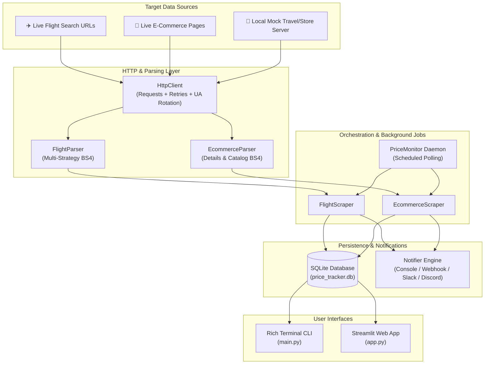
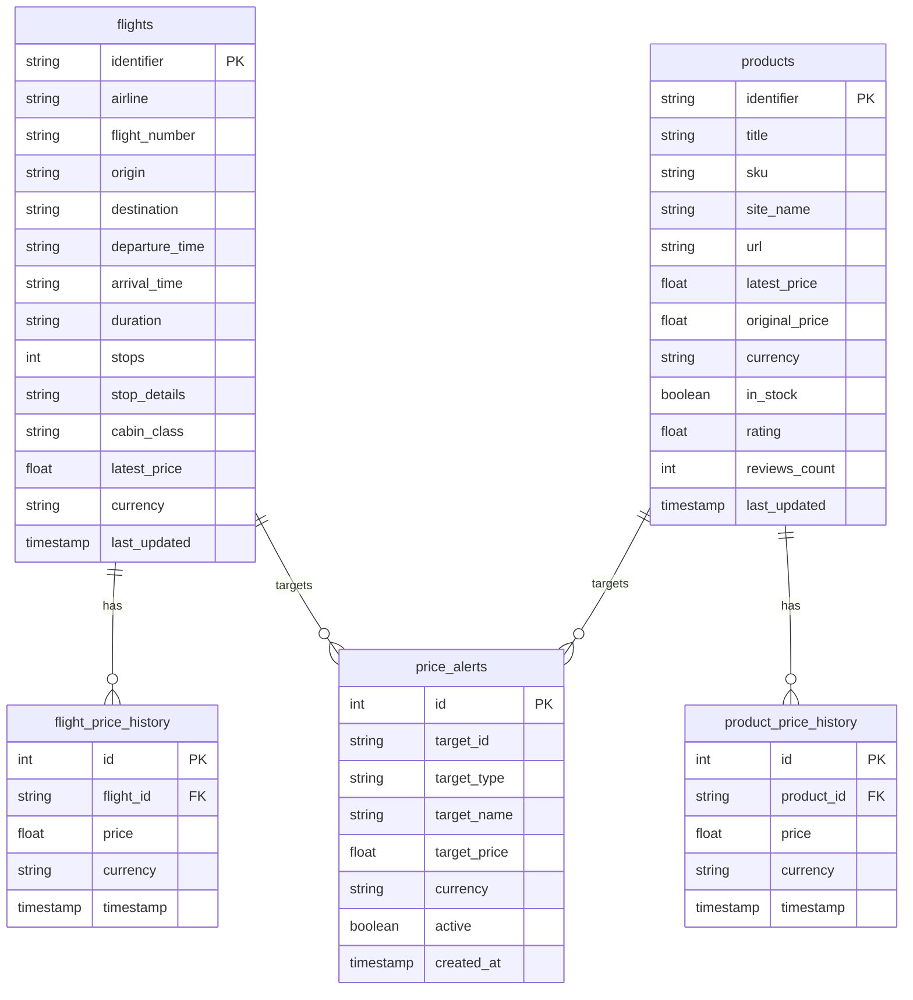

# ✈️ E-Commerce & Flight Web Price Tracker

<div align="center">

[](https://www.python.org/)
[](https://streamlit.io/)
[](https://www.crummy.com/software/BeautifulSoup/)
[](https://www.sqlite.org/)
[](LICENSE)
[](#-running-the-test-suite)

**A high-performance, resilient web scraping and price tracking suite for airline itineraries and e-commerce products.**  
Extract prices, track historical volatility in SQLite, detect price drops, and dispatch real-time alerts to the terminal, Discord, or Slack.

[Quickstart](#-quickstart) • [Key Features](#-key-features) • [CLI Commands](#-cli-reference-mainpy) • [Web Dashboard](#-streamlit-web-dashboard-apppy) • [Architecture](#-architecture) • [Webhooks](#-webhook-notifications)

</div>

---

## 📖 Table of Contents

- [Overview](#-overview)
- [Key Features](#-key-features)
- [Architecture & Workflow](#-architecture--workflow)
- [Project Structure](#-project-structure)
- [Quickstart](#-quickstart)
  - [Prerequisites](#prerequisites)
  - [Installation](#installation)
  - [Running the Interactive Demo](#running-the-interactive-demo)
- [CLI Reference (`main.py`)](#-cli-reference-mainpy)
- [Streamlit Web Dashboard (`app.py`)](#-streamlit-web-dashboard-apppy)
- [Automated Continuous Price Monitor](#-automated-continuous-price-monitor)
- [Webhook Notifications (Discord / Slack)](#-webhook-notifications)
- [SQLite Storage & Historical Analytics](#-sqlite-storage--historical-analytics)
- [Built-in Mock Server & Flash Sale Simulation](#-built-in-mock-server--flash-sale-simulation)
- [Running the Test Suite](#-running-the-test-suite)
- [Extending with Custom Parsers](#-extending-with-custom-parsers)
- [Contributing](#-contributing)
- [License](#-license)

---

## 🔍 Overview

Price fluctuations on flight booking sites and online stores can be erratic and difficult to track manually. **E-Commerce & Flight Web Price Tracker** is a modular Python platform engineered to:

1. **Extract data reliably**: Employs HTTP session persistence, exponential backoff retries, and randomized User-Agent rotation to handle live web endpoints without brittle failures.
2. **Parse messy markup**: Uses multi-strategy BeautifulSoup logic (CSS selectors, `data-*` attributes, semantic regex heuristics) to reliably pull pricing, itinerary times, stopovers, cabin class, stock status, ratings, and SKUs.
3. **Persist time-series price points**: Stores every check in an ACID-compliant SQLite database, tracking all-time lows, highs, averages, and net price changes.
4. **Trigger real-time alerts**: Automatically monitors threshold conditions and dispatches alerts via console notifications, desktop logs, or Discord/Slack webhooks.
5. **Visualize trends**: Delivers both an interactive CLI powered by Rich and an interactive web dashboard built with Streamlit.

---

## 🌟 Key Features

| Category | Highlights |
|---|---|
| **✈️ Flight Scraping** | Airline name, flight number, origin, destination, departure/arrival schedules, total duration, stop count, layover airport details, cabin classes, and clean numeric fares across currencies (`USD`, `EUR`, `GBP`, `INR`, etc.). |
| **🛒 E-Commerce Scraping** | Single product detail pages & catalog listings, current vs. original list price, discount %, stock availability, customer ratings, review volume, and SKU extraction. |
| **🛡️ Resilient HTTP Engine** | Exponential backoff retry adapter (`urllib3`), randomized browser User-Agents, request headers emulation, and timeout safeguards. |
| **📊 Trend & Volatility Analytics** | Historical time-series analytics, all-time lowest/highest observed prices, moving averages, net price change %, and frequency of price drop events. |
| **🔔 Smart Alerting Engine** | Target threshold triggers (`current_price <= target_price`), price drop delta calculation, console banners, and Webhook dispatch (Discord, Slack, custom HTTP). |
| **⏱️ Automated Monitor Daemon** | Background polling engine (`PriceMonitor`) that cycles through monitored targets on a scheduled interval. |
| **🌐 Modern Web Dashboard** | Full-featured Streamlit UI with 4 interactive tabs, live line charts, mock flash sale controls, CSV downloads, and alert toggles. |
| **🧪 Local Mock Server** | Built-in HTTP server providing realistic flight search and e-commerce catalog endpoints, complete with dynamic variance triggers (`/trigger-discount`). |

---

## 🏗️ Architecture & Workflow



---

## 📁 Project Structure

```
E-commerce-web-price-tracker/
├── app.py                         # Streamlit interactive web dashboard
├── main.py                        # Rich CLI application with subcommands
├── requirements.txt               # Python package dependencies
├── README.md                      # Project documentation
├── LICENSE                        # MIT License
├── .gitignore                     # Git exclusion rules
│
├── data/
│   └── price_tracker.db           # SQLite database (auto-initialized)
│
├── tracker/
│   ├── __init__.py                # Package exports and version metadata
│   ├── config.py                  # HTTP headers, retry limits, DB path, webhooks
│   ├── client.py                  # Requests.Session wrapper with retry strategy & UA rotation
│   ├── models.py                  # FlightItem, ProductItem, PriceAlert dataclasses
│   ├── monitor.py                 # PriceMonitor engine for automated polling
│   │
│   ├── parsers/
│   │   ├── base_parser.py         # Currency detection, price sanitization, regex duration
│   │   ├── flight_parser.py       # Multi-strategy HTML flight itinerary parser
│   │   └── ecommerce_parser.py    # Product details & catalog listing parser
│   │
│   ├── scrapers/
│   │   ├── flight_scraper.py      # Orchestrator for flight retrieval, parsing, storage & alerts
│   │   └── ecommerce_scraper.py   # Orchestrator for product retrieval, parsing, storage & alerts
│   │
│   ├── storage/
│   │   └── database.py            # SQLite manager: time-series history, stats, alerts, CSV export
│   │
│   ├── alerts/
│   │   └── notifier.py            # Alert formatting and webhook POST dispatcher
│   │
│   └── mock_server/
│       ├── server.py              # Local HTTP mock travel portal & catalog endpoints
│       └── flight_fixtures.py     # HTML template generator with price variance controls
│
└── tests/
    ├── test_base_parser.py        # Currency & numerical extraction tests
    ├── test_client.py             # Session configuration & retry strategy tests
    ├── test_database.py           # SQLite transactions, history & alert matching tests
    ├── test_ecommerce_parser.py   # Product and catalog HTML parsing tests
    ├── test_flight_parser.py      # Multi-layout flight card parsing tests
    ├── test_notifier.py           # Alert formatting & webhook payload tests
    ├── test_monitor.py            # PriceMonitor loop & scraping coordination tests
    └── test_storage_extended.py   # Alert toggling, deletion, analytics & CSV export tests
```

---

## 🚀 Quickstart

### Prerequisites

- **Python**: Version `3.10` or higher
- **Git**

### Installation

1. **Clone the repository:**
   ```bash
   git clone https://github.com/your-username/E-commerce-web-price-tracker.git
   cd E-commerce-web-price-tracker
   ```

2. **Create and activate a virtual environment (recommended):**
   ```bash
   # Windows (PowerShell)
   python -m venv venv
   .\venv\Scripts\Activate.ps1

   # Linux / macOS
   python3 -m venv venv
   source venv/bin/activate
   ```

3. **Install dependencies:**
   ```bash
   pip install -r requirements.txt
   ```

### Running the Interactive Demo

Test the complete end-to-end extraction, price tracking, mock flash sale, and alerting workflow with a single command:

```bash
python main.py demo
```

```
┌─────────────────────────────────────────────────────────────────────────────┐
│ E-Commerce & Flight Web Price Tracker Demo                                  │
│ Tech Stack: Python + Requests + BeautifulSoup + SQLite                      │
│ Demonstrating HTTP retrieval, HTML parsing, price tracking, and drop        │
│ alerting.                                                                   │
└─────────────────────────────────────────────────────────────────────────────┘

Step 1: Scraping Flight Search Results from: http://127.0.0.1:8877/flights?from=JFK&to=LHR
                  Round 1: Initial Flight Fares (JFK -> LHR)                   
┌─────────────────┬────────┬────────┬───────┬────────┬───────┬────────┬───────┐
│ Airline         │ Flight │ Route  │ Times │ Durat  │ Stops │ Cabin  │ Price │
├─────────────────┼────────┼────────┼───────┼────────┼───────┼────────┼───────┤
│ SkyLink Airways │ SL 100 │ JFK✈LHR│ 06:30 │ 7h 15m │ Nonst │ Economy│ USD621│
│ Pacific Jet     │ PJ 469 │ JFK✈LHR│ 05:20 │ 7h 15m │ 1 stop│ Economy│ USD442│
└─────────────────┴────────┴────────┴───────┴────────┴───────┴────────┴───────┘

Step 2: Setting Price Alert on Pacific Jet PJ 469 at target USD 422.80
Step 3: Simulating Airline Flash Sale (-$60 on all fares)...
Step 4: Re-scraping Flight Search to Detect Price Drop & Alert...
🔔 [ALERT TRIGGERED] FLIGHT: Pacific Jet PJ 469
   Current Price: USD 382.80 <= Target: USD 422.80! (You save: USD 40.00)

✓ Demo completed successfully!
```

---

## 💻 CLI Reference (`main.py`)

The application includes a rich command-line interface with subcommands for all core capabilities:

| Subcommand | Purpose | Syntax Example |
|---|---|---|
| `demo` | Run full end-to-end automated demo | `python main.py demo` |
| `scrape-flights` | Scrape flight search fares from URL or mock origin/destination | `python main.py scrape-flights --origin JFK --dest LHR --currency USD` |
| `scrape-product` | Scrape a single product detail page | `python main.py scrape-product "http://127.0.0.1:8765/product/1" --site TechStore` |
| `scrape-catalog` | Scrape a multi-product catalog or listing page | `python main.py scrape-catalog "http://127.0.0.1:8765/products" --site TechStore` |
| `history` | View tracked flights & products summary table | `python main.py history` |
| `analytics` | Display volatility, net change %, and drop events for an item | `python main.py analytics Pacific_Jet_PJ469_JFK_LHR --type flight` |
| `list-alerts` | View all configured price threshold alerts | `python main.py list-alerts` |
| `set-alert` | Set a price drop threshold alert | `python main.py set-alert Pacific_Jet_PJ469_JFK_LHR flight "Pacific Jet" 400.0` |
| `check-alerts` | Evaluate active alerts against latest recorded prices | `python main.py check-alerts` |
| `toggle-alert` | Enable/disable an alert by ID | `python main.py toggle-alert 1` |
| `delete-alert` | Permanently remove an alert by ID | `python main.py delete-alert 1` |
| `monitor` | Start the automated continuous price polling daemon | `python main.py monitor --interval 60` |
| `export` | Export flights, products, history, or alerts to CSV | `python main.py export data/flights_backup.csv --type flights` |
| `serve-mock` | Start the local test server for flights and products | `python main.py serve-mock --port 8765` |

### CLI Examples

**Check Price Trend Analytics for a Flight:**
```bash
python main.py analytics Pacific_Jet_PJ469_JFK_LHR --type flight
```

**Export Price History to CSV:**
```bash
python main.py export data/price_history.csv --type flight_history --id Pacific_Jet_PJ469_JFK_LHR
```

---

## 🌐 Streamlit Web Dashboard (`app.py`)

Launch the web application with:

```bash
streamlit run app.py
```

The browser will open to `http://localhost:8501`.

```
========================================================================================
✈️ PriceTracker Hub (Streamlit UI)
========================================================================================
[Sidebar: Live Metrics] Flights: 5 | Products: 3 | Active Alerts: 2 | Triggered: 1
[Mock Controls] [Drop Flight -$60]  [Drop Prod -$50]  [Reset Prices]
----------------------------------------------------------------------------------------
Tabs: [🔍 Flight Tracker]  [🛒 E-Commerce Tracker]  [📈 Price History & Trends]  [🔔 Alerts]
----------------------------------------------------------------------------------------
• Flight Tracker: Select origin/destination/currency or paste custom URL to extract fares.
• E-Commerce Tracker: Single product mode (ratings, stock, SKU) or catalog grid mode.
• Price History & Trends: Interactive line charts over time with 1-click CSV download.
• Price Drop Alerts: Real-time triggered alert banner, savings calculation, toggle/delete.
========================================================================================
```

### Dashboard Tabs Overview

1. **🔍 Flight Tracker Tab**:
   - Airport dropdown presets (`JFK`, `SFO`, `DEL`, `LHR`, `DXB`, etc.) or custom flight portal URL.
   - Clean tabular output with departure/arrival times, stops, cabin, and fare.
   - Quick one-click price alert creator.

2. **🛒 E-Commerce Tracker Tab**:
   - Single product mode: extracts product title, live price, original price, discount %, stock availability, customer ratings, review counts, and SKU.
   - Catalog mode: scrapes listing grids and extracts multi-product tables.

3. **📈 Price History & Trends Tab**:
   - Interactive time-series price line charts using Streamlit charting.
   - Volatility analytics cards: Initial Recorded Price, Current Latest Price, Lowest Ever, Net Change %, and Total Drop Events.
   - Direct CSV download button.

4. **🔔 Price Drop Alerts Tab**:
   - Highlighted banner displaying any active alerts triggered by recent price drops.
   - Savings calculation (`target_price - current_price`).
   - Management table with ID-based toggle and deletion controls.

---

## ⏱️ Automated Continuous Price Monitor

The `PriceMonitor` daemon ([`tracker/monitor.py`](tracker/monitor.py)) continuously checks target URLs and dispatches alerts when discounts occur:

```bash
# Monitor all tracked flights and products every 120 seconds
python main.py monitor --interval 120

# Monitor specific URLs for 10 iterations
python main.py monitor --interval 30 --iterations 10 --flight-urls "http://127.0.0.1:8765/flights?from=JFK&to=LHR"
```

You can also use `PriceMonitor` in your own Python scripts:

```python
from tracker.monitor import PriceMonitor

monitor = PriceMonitor()
monitor.add_flight_url("http://127.0.0.1:8765/flights?from=JFK&to=LHR")
monitor.add_product_url("http://127.0.0.1:8765/product/1")

# Run a single check
summary = monitor.run_once()
print(f"Scraped {summary['flights_scraped']} flights, triggered {summary['alerts_triggered_count']} alerts.")

# Or run continuous loop
monitor.run_loop(interval_seconds=60)
```

---

## 🔔 Webhook Notifications

Deliver instant alerts to Discord channels, Slack incoming webhooks, or custom HTTP endpoints.

### Setting up Discord / Slack Webhooks

Set the environment variable `PRICE_ALERT_WEBHOOK_URL`:

```bash
# Windows PowerShell
$env:PRICE_ALERT_WEBHOOK_URL="https://discord.com/api/webhooks/YOUR_WEBHOOK_ID/YOUR_WEBHOOK_TOKEN"

# Linux / macOS
export PRICE_ALERT_WEBHOOK_URL="https://hooks.slack.com/services/YOUR/WEBHOOK/KEY"
```

### Webhook JSON Payload Structure

The `Notifier` sends payloads formatted for cross-compatibility with Discord and Slack:

```json
{
  "title": "Price Alert: Pacific Jet PJ 469",
  "content": "**Price Alert: Pacific Jet PJ 469**\n[ALERT TRIGGERED] FLIGHT: Pacific Jet PJ 469\n   Current Price: USD 382.80 <= Target: USD 422.80!\n   You save: USD 40.00",
  "text": "*Price Alert: Pacific Jet PJ 469*\n[ALERT TRIGGERED] FLIGHT: Pacific Jet PJ 469...",
  "data": {
    "target_name": "Pacific Jet PJ 469",
    "latest_price": 382.80,
    "target_price": 422.80,
    "currency": "USD",
    "target_type": "flight"
  }
}
```

---

## 🗄️ SQLite Storage & Historical Analytics

The SQLite engine (`data/price_tracker.db`) uses four normalized tables:



---

## 🧪 Built-in Mock Server & Flash Sale Simulation

To test scraping logic offline without hitting third-party anti-bot barriers, the project includes an internal HTTP test portal:

```bash
python main.py serve-mock --port 8765
```

Endpoints provided:
- `GET /flights?from=JFK&to=LHR&currency=USD` — Dynamic flight search HTML.
- `GET /product/1` — E-commerce product details HTML.
- `GET /products` — E-commerce catalog list HTML.
- `GET /trigger-discount` — Simulates a -$60 airline price cut to trigger flight alerts.
- `GET /trigger-product-discount` — Simulates a -$50 store price cut to trigger product alerts.
- `GET /reset-prices` — Resets mock variances to baseline.

---

## 🧪 Running the Test Suite

The project includes unit and integration tests covering text parsing, HTTP retries, SQLite storage, mock servers, notifiers, and the monitoring loop.

Execute all tests with:

```bash
python -m unittest discover tests
```

Expected output:
```
....................
----------------------------------------------------------------------
Ran 20 tests in 1.450s

OK
```

---

## 🛠️ Extending with Custom Parsers

To extract from a specific flight or e-commerce website with unique markup, provide custom CSS selectors:

```python
from tracker.parsers.flight_parser import FlightParser
from bs4 import BeautifulSoup

custom_selectors = {
    "container": ".custom-flight-card",
    "airline": ".airline-name",
    "flight_number": ".flight-code",
    "origin": ".dep-code",
    "destination": ".arr-code",
    "departure_time": ".departure-time",
    "arrival_time": ".arrival-time",
    "duration": ".flight-duration",
    "stops": ".stops-count",
    "price": ".total-fare-amount",
    "cabin_class": ".travel-class",
}

parser = FlightParser(custom_selectors=custom_selectors)
flights = parser.parse(html_content)
```

---

## 🤝 Contributing

Contributions, feature requests, and issue reports are welcome!

1. Fork the repository
2. Create your feature branch (`git checkout -b feature/awesome-feature`)
3. Commit your changes (`git commit -m "feat: add awesome feature"`)
4. Run the test suite (`python -m unittest discover tests`)
5. Push to the branch (`git push origin feature/awesome-feature`)
6. Open a Pull Request

---

## 📄 License

This project is licensed under the MIT License — see the [LICENSE](LICENSE) file for details.
