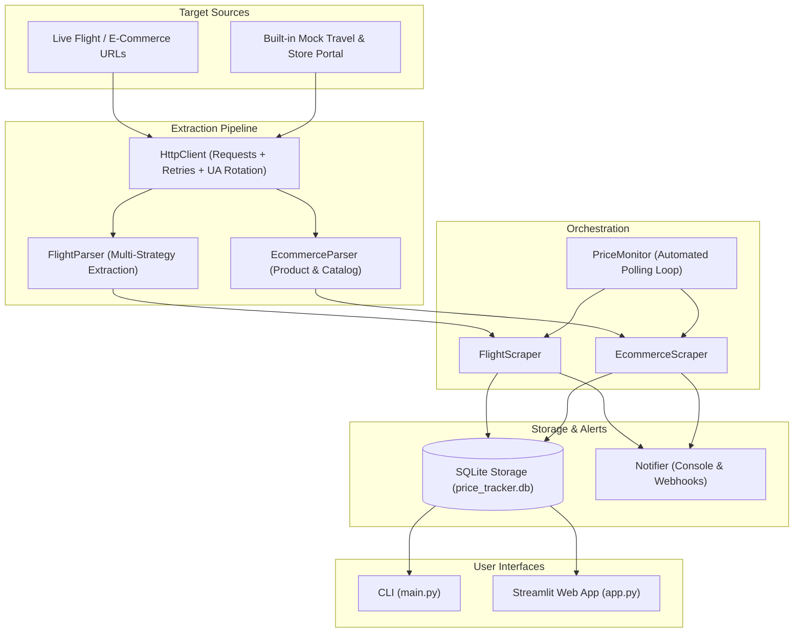

# ✈️ E-Commerce & Flight Web Price Tracker

A high-performance, modular web price tracking engine built with **Python**, **Requests**, **BeautifulSoup**, and **SQLite**. It extracts, tracks, and analyzes flight fares and e-commerce product prices over time, detecting price drops and dispatching alerts via terminal, desktop logs, or webhooks (Discord / Slack).

---

## 🌟 Key Features

- **Multi-Strategy HTML Parsing**: Robust BeautifulSoup parsers resilient to dynamic CSS classes, semantic changes, and messy markup using selector chains, `data-*` attributes, and regex heuristics.
- **Resilient HTTP Engine**: Session persistence, automatic retries with exponential backoff (`urllib3.util.retry`), randomized browser User-Agent rotation, and standard headers emulation.
- **Flight Fare Intelligence**: Extracts airline, flight numbers, origins, destinations, departure/arrival schedules, durations, stop counts, layover details, cabin classes, and clean numeric prices across multiple currencies (`USD`, `EUR`, `GBP`, `INR`, etc.).
- **E-Commerce Catalog & Product Extraction**: Supports both single product detail pages (title, price, original price, discount %, stock status, star ratings, review counts, SKU) and multi-item catalog/listing pages.
- **SQLite Historical Analytics Engine**: Tracks price history time-series, calculates moving averages, all-time lows/highs, net changes, and price volatility.
- **Threshold Alerting & Webhooks**: Triggers real-time alerts when prices hit or dip below a target price, supporting console banners and Webhook POST requests (Discord / Slack / generic HTTP).
- **Automated Price Monitor Daemon**: Continuous background monitoring loop that periodically checks tracked targets and triggers alerts.
- **Interactive Streamlit Dashboard**: Full-featured web interface with interactive flight search, product extraction, price history line charts, CSV export, and alert management.
- **Built-in Mock Server & Fixtures**: Local HTTP test server with dynamic flight search results and e-commerce endpoints, including flash sale simulation triggers (`/trigger-discount`, `/trigger-product-discount`).
- **Comprehensive Test Suite**: Unit and integration test coverage across client, parsers, database, alerts, and monitor.

---

## 🏗️ Architecture



---

## 📁 Project Structure

```
E-commerce-web-price-tracker/
│
├── app.py                     # Streamlit interactive web dashboard
├── main.py                    # Rich CLI interface with subcommands
├── requirements.txt           # Python dependencies
├── README.md                  # Comprehensive documentation
│
├── data/
│   └── price_tracker.db       # SQLite historical database (auto-created)
│
├── tracker/
│   ├── __init__.py            # Module exports
│   ├── config.py              # User-agents, HTTP settings, headers, DB path
│   ├── client.py              # Robust requests.Session with retries & headers
│   ├── models.py              # FlightItem, ProductItem, PriceAlert dataclasses
│   ├── monitor.py             # PriceMonitor daemon for continuous polling
│   │
│   ├── parsers/
│   │   ├── base_parser.py     # Regex cleaning, currency & price extraction
│   │   ├── flight_parser.py   # Multi-strategy BeautifulSoup flight parser
│   │   └── ecommerce_parser.py# Product details & catalog listing parser
│   │
│   ├── scrapers/
│   │   ├── flight_scraper.py  # Coordinates flight fetching, parsing, DB, alerts
│   │   └── ecommerce_scraper.py# Coordinates product fetching, parsing, DB, alerts
│   │
│   ├── storage/
│   │   └── database.py        # SQLite engine: history, stats, alerts, CSV export
│   │
│   ├── alerts/
│   │   └── notifier.py        # Console formatting & webhook dispatch
│   │
│   └── mock_server/
│       ├── server.py          # Local HTTP mock travel & catalog portal
│       └── flight_fixtures.py # Dynamic flight HTML generation with variance
│
└── tests/
    ├── test_base_parser.py    # Unit tests for text & price parsing
    ├── test_client.py         # Unit tests for HTTP client
    ├── test_database.py       # Unit tests for database transactions & alerts
    ├── test_ecommerce_parser.py # Unit tests for e-commerce parsing
    ├── test_flight_parser.py  # Unit tests for flight markup parsing
    ├── test_notifier.py       # Unit tests for alerts and webhook payload
    ├── test_monitor.py        # Unit tests for automated monitor loop
    └── test_storage_extended.py # Unit tests for alert management & CSV export
```

---

## 🚀 Quickstart

### 1. Installation

Clone or navigate to the repository directory, then install the dependencies:

```bash
pip install -r requirements.txt
```

Dependencies include:
- `requests>=2.31.0`
- `beautifulsoup4>=4.12.0`
- `lxml>=4.9.0`
- `rich>=13.0.0`
- `streamlit>=1.30.0`
- `pydantic>=2.0.0`

### 2. Run the End-to-End Demo

Run the automated CLI demonstration:

```bash
python main.py demo
```

The demo spins up an internal mock server, scrapes flight and product pages, creates a threshold price alert, triggers a flash sale discount, detects the price drop, dispatches the alert, and displays historical database analytics.

---

## 💻 CLI Commands (`main.py`)

The application provides a command-line interface powered by `rich`:

| Command | Description | Example |
|---|---|---|
| `demo` | Run full end-to-end interactive demo | `python main.py demo` |
| `scrape-flights` | Scrape flight search results | `python main.py scrape-flights --origin JFK --dest LHR` |
| `scrape-product` | Scrape single product page | `python main.py scrape-product "http://127.0.0.1:8765/product/1"` |
| `scrape-catalog` | Scrape product catalog page | `python main.py scrape-catalog "http://127.0.0.1:8765/products"` |
| `history` | View tracked flights & products | `python main.py history` |
| `analytics` | View trend & volatility analytics | `python main.py analytics Pacific_Jet_PJ469_JFK_LHR --type flight` |
| `list-alerts` | List all configured price alerts | `python main.py list-alerts` |
| `set-alert` | Set a target threshold alert | `python main.py set-alert FLIGHT_ID flight "Flight Name" 400.0` |
| `check-alerts` | Check if any active alerts are triggered | `python main.py check-alerts` |
| `toggle-alert` | Toggle alert active state (enable/disable) | `python main.py toggle-alert 1` |
| `delete-alert` | Delete a price alert by ID | `python main.py delete-alert 1` |
| `monitor` | Start continuous monitoring daemon | `python main.py monitor --interval 60` |
| `export` | Export dataset to CSV file | `python main.py export flights.csv --type flights` |
| `serve-mock` | Start local mock web portal | `python main.py serve-mock --port 8765` |

---

## 🌐 Streamlit Web Dashboard (`app.py`)

To launch the web dashboard:

```bash
streamlit run app.py
```

The web dashboard provides four dedicated tabs:

1. **🔍 Flight Tracker**: Interactive airport selector (JFK, SFO, DEL, LHR, DXB, etc.), custom URL input, structured fare listings, and one-click price drop alert setup.
2. **🛒 E-Commerce Tracker**: Scrape single product pages or full product catalogs, inspect current vs. original prices, discount percentages, stock status, ratings, and configure threshold alerts.
3. **📈 Price History & Trends**: Historical time-series price charts, price volatility analytics (net change %, lowest price ever, number of drop events), and CSV history download.
4. **🔔 Price Drop Alerts**: Overview of active alerts, real-time triggered alert warnings with savings calculations, and buttons to toggle or delete alerts.
5. **🧪 Sidebar Mock Testing**: Control simulated flash sales (-$60 on flights, -$50 on products) and reset prices with one click.

---

## 🔔 Webhook Notifications (Discord / Slack / Custom)

To receive real-time notifications on price drops or triggered threshold alerts, set the `PRICE_ALERT_WEBHOOK_URL` environment variable:

```bash
# Windows PowerShell
$env:PRICE_ALERT_WEBHOOK_URL="https://discord.com/api/webhooks/your/webhook/url"

# Linux / macOS
export PRICE_ALERT_WEBHOOK_URL="https://hooks.slack.com/services/your/webhook/url"
```

The notifier automatically formats payloads compatible with Discord, Slack, and standard JSON webhook receivers.

---

## 🧪 Running the Test Suite

Run all unit and integration tests using Python's built-in `unittest` runner:

```bash
python -m unittest discover tests
```

---

## 🛠️ Extending with Custom Parsers

To target custom websites, you can subclass `BaseParser` or supply custom CSS selectors:

```python
from tracker.parsers.flight_parser import FlightParser

custom_selectors = {
    "container": ".custom-flight-card",
    "airline": ".carrier-title",
    "flight_number": ".code-label",
    "origin": ".dep-airport",
    "destination": ".arr-airport",
    "departure_time": ".time-dep",
    "arrival_time": ".time-arr",
    "duration": ".fly-duration",
    "price": ".total-fare",
}

parser = FlightParser(custom_selectors=custom_selectors)
flights = parser.parse(html_content)
```
